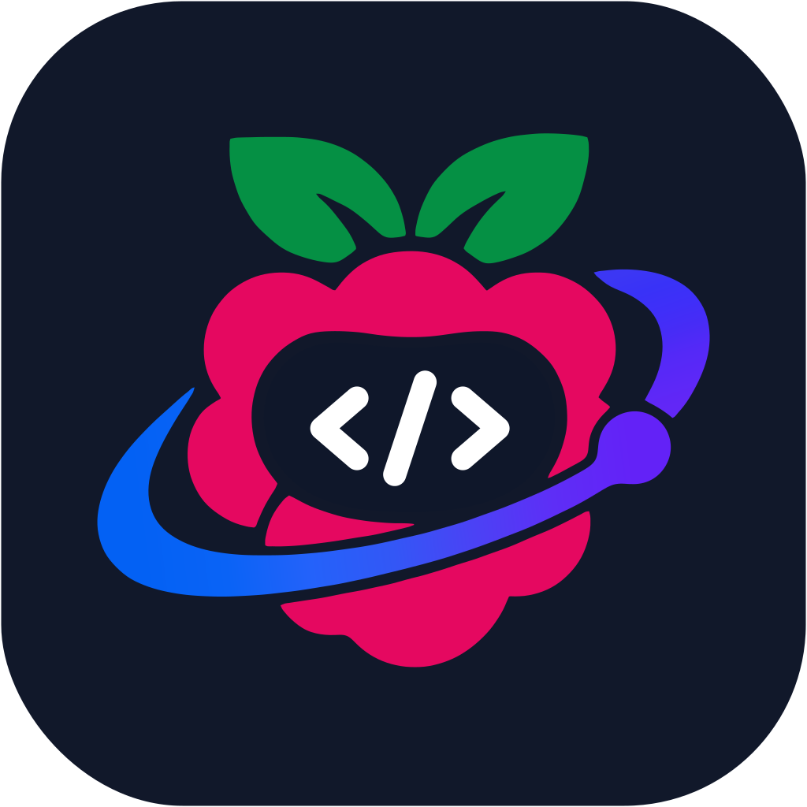

# RaspberryCode

<div align="center">
  
</div>
<p align="center">
  简体中文 | <a href="README.en.md">English</a>
</p>

RaspberryCode 是 AI 编程工作台，提供桌面应用和终端 Agent。本仓库包含客户端、后端服务、共享 UI，以及 Agent CLI 与运行时源码。

## 初始化

准备 Git、Node.js **24.14.0** 和 pnpm **10.33.2**，版本以 [mise.toml](mise.toml) 为准。以下开发和打包命令均在仓库根目录执行。

```bash
pnpm bootstrap
```

`pnpm bootstrap` 安装 workspace 依赖、准备桌面本地运行资源，再执行 `build:bootstrap`。

Agent CLI 与运行时源码位于 [apps/raspberrycode-cli/](apps/raspberrycode-cli/)，作为普通目录随本仓库一起克隆，无需单独拉取或初始化 Git submodule。

根据需要选择其他初始化或构建入口：

| 命令                           | 用途                                                              |
| ------------------------------ | ----------------------------------------------------------------- |
| `pnpm install`                 | 安装依赖                                                          |
| `pnpm prepare:desktop-runtime` | 准备桌面运行资源，默认包含远程资源准备                            |
| `pnpm prepare:remote-assets`   | 单独准备远程运行资源                                              |
| `pnpm bootstrap:with-remote`   | 初始化依赖、本地与远程资源，并串行构建相关包；跳过桌面应用 bundle |
| `pnpm build`                   | 递归执行各 workspace 包的构建脚本，包括包内的资源准备步骤         |

默认 `bootstrap` 跳过远程资源准备，适合本地桌面开发。使用远程工作区或验证远程发行资源时，再运行对应准备命令。

## 开发与运行

### 桌面版

```bash
pnpm dev:desktop

# 使用测试环境
pnpm dev:desktop:test
```

`pnpm dev:desktop` 默认等同于 `pnpm dev:desktop:prod`，使用生产服务配置。启动脚本会准备本地运行资源、构建桌面 Agent，再启动 Electron 和源码监听。

需要独立开发数据目录时，可设置 `RASPBERRYCODE_DATA_BASE_DIR`。例如在 macOS / Linux 中：

```bash
RASPBERRYCODE_DATA_BASE_DIR="$HOME/.raspberrycode-dev-home" pnpm dev:desktop:test
```

### 远程功能（SSH/WSL）

先执行 `pnpm bootstrap:with-remote` 准备远程资源（mock-cdn），再 `pnpm dev:desktop`；连接远程项目时资源选择「本地下载后上传」。开发态资源取自本地 `packages/desktop/mock-cdn` 和本地构建产物，经 SFTP 上传到远程，不访问 CDN。

### 服务端开发

后端源码修改时，使用开发模式：

```bash
pnpm dev:server
```

Agent 源码修改后，执行 `pnpm --filter @raspberrycode/cli... build` 并重启服务。需要验证完整发行包时，按下方“RaspberryCode 命令行版”打包章节解压运行。

### RaspberryCode 命令行版

命令行发行包包含 TUI 和 Agent，统一使用 `raspberrycode` 启动：无参数进入 TUI；其他参数交给 Agent CLI 处理。在本机运行，无需 Electron。

```bash
# 默认进入终端交互界面
raspberrycode

# 查看 CLI 参数
raspberrycode --help

# 查看发行包版本
raspberrycode --version
```

直接启动通用 Web 服务的 HTTP 入口（`server/entry-http.js`，bot 回调等）时，通过 `RASPBERRYCODE_SERVER_AUTH_TOKEN` 配置 API／WebSocket 认证；通过程序接口创建服务时，使用 `authToken` 选项。

构建方式见下方打包章节。`pnpm build:raspberrycode` 只生成发行包，不会替换 `PATH` 中已有的 `raspberrycode`。如果命令仍指向旧安装或其他源码目录，macOS / Linux 可用 `command -v raspberrycode` 检查，Windows 可用 `where.exe raspberrycode` 检查。

### CLI 源码开发

CLI 的模型配置、非交互调用、工具与扩展、批量评测和轨迹记录见 [CLI 使用指南](apps/raspberrycode-cli/docs/usage/README.md)。

直接开发 TUI 或 Agent 时，运行源码入口：

```bash
pnpm --filter @raspberrycode/cli dev --help
pnpm --filter @raspberrycode/cli dev

# 构建 CLI 及其 workspace 依赖
pnpm --filter @raspberrycode/cli... build
node apps/raspberrycode-cli/packages/cli/dist/raspberrycode.cjs --help
```

这个入口直接运行 Agent CLI。验证统一的 `raspberrycode` 命令，用下方解压后的 `bin/raspberrycode.mjs`。

### UI Plugin 开发

参见 [UI Plugin：能力、API 与调试](UI_PLUGIN.md)，从 Excalidraw 的画布协作示例开始，了解插件安装更新、页面 API 和宿主联调入口。

**向 `raspberrycode-plugins` 提交插件 PR 时，必须在 PR 模板中声明是否为 UI Plugin，并填写插件名称。** 判断标准见[提交 PR 时声明插件类型](UI_PLUGIN.md#提交-pr-时声明插件类型)。

## 配置

根目录 [.env.example](.env.example) 提供服务地址与构建配置示例，可按需复制到 `.env`，本地覆盖放入 `.env.local`。Desktop 的开发环境通过 `dev:desktop:test` / `dev:desktop:prod` 选择。

| 配置                                 | 用途                                             |
| ------------------------------------ | ------------------------------------------------ |
| `RASPBERRYCODE_DATA_BASE_DIR`                | 应用数据基目录，数据写入其下的 `.raspberrycode/`         |
| `RASPBERRYCODE_SERVER_WORKSPACE`             | Web 后端的工作区路径                             |
| `RASPBERRYCODE_BUILTIN_PROVIDER_CONFIG_FILE` | 本地 Provider 配置文件路径；未设置时使用内置配置 |
| `RASPBERRYCODE_DIST_BASE_URL`                | 命令行安装脚本使用的下载根地址                   |

运行时变量可在启动命令的环境中显式设置。随客户端发布的默认配置见 [config/README.md](config/README.md)。

## 打包

第三方声明生成、发行校验流程及声明在发行物中的位置见 [third-party/README.md](third-party/README.md)。

### 桌面版

```bash
pnpm bundle:desktop

# 指定目标平台与 CPU 架构
pnpm bundle:desktop -- --os win --arch x64

pnpm bundle:desktop -- --help
```

默认目标为 macOS arm64，默认输出目录为 `packages/desktop/dist/`。`--os` 支持 `mac`、`win`、`linux`，`--arch` 支持 `x64`、`arm64`；实际打包与签名需要目标平台对应的工具和配置。

安装：双击打开产物 DMG，将 RaspberryCode 拖入"应用程序"。本地构建未签名，首次打开若被 macOS 拦截，执行：

```bash
sudo xattr -rd com.apple.quarantine /Applications/RaspberryCode.app
```

### 发布检查清单

发行构建前须替换默认托管地址（默认值指向公共 CDN 占位，自托管发行不改会指向外部基础设施）：

| 检查项 | 替换方式 |
| ------ | -------- |
| 下载根地址 `RASPBERRYCODE_DIST_BASE_URL` | 构建环境变量或 `--base-url`（见下方命令行版章节） |
| 远程资源 CDN 根（远程部署资源下载） | 构建期设置 `CDN_DOMAIN`（逗号分隔可多域名，配 `OSS_PATH_PREFIX`），由打包时注入 `__RASPBERRYCODE_REMOTE_CDN_RELEASE_ROOTS__` |
| 遥测上报端点 `RASPBERRYCODE_TELEMETRY_REPORT_ENDPOINT` | 不设置即不发送遥测（默认关闭）；接入自有收集端时按构建配置注入 |

### RaspberryCode 命令行版

构建入口为 `pnpm build:raspberrycode`。脚本会依次构建 CLI/TUI 和后端，收集 TUI 的原生库、worker 与运行时依赖，再组装发行包；运行发行包仍需要 Node.js，版本以 `mise.toml` 为准。

打包前必须设置下载根地址 `RASPBERRYCODE_DIST_BASE_URL`（可放在 `.env`、`.env.local` 或环境变量中），也可以通过 `--base-url` 传入。以下地址是占位示例，发布时替换为实际托管地址：

```bash
pnpm build:raspberrycode --base-url https://downloads.example.com/raspberrycode/

# 已配置 RASPBERRYCODE_DIST_BASE_URL 时
pnpm build:raspberrycode

# 仅重新组包，复用已有的 Agent 和后端构建产物
pnpm build:raspberrycode --skip-build

# 查看版本、输出目录等可选参数
pnpm build:raspberrycode --help
```

默认版本取根目录 `package.json`，输出目录为 `dist/raspberrycode/`：

- `releases/<version>/raspberrycode-<version>.tar.gz`：运行包。
- `releases/<version>/sha256.txt`：校验摘要。
- `latest.json`、`install.sh`：版本索引和安装脚本。

完整目录可上传到配置的下载根地址。安装脚本从该地址下载运行包，默认安装到 `~/.raspberrycode/runtime`，并在 `~/.local/bin` 创建 `raspberrycode` 命令。安装目录可通过 `RASPBERRYCODE_DIST_HOME` 修改，命令目录可通过 `RASPBERRYCODE_DIST_BIN_DIR` 修改。

旧 Lite 用户需要改用上述构建命令、环境变量和新的安装脚本。新安装不会删除旧 Lite 目录，也不会迁移或删除已有会话数据。

本地调试打包产物时，可直接解压运行，无需上传或安装：

```bash
raspberrycode_version=$(node -p "require('./dist/raspberrycode/latest.json').version")
mkdir -p dist/raspberrycode/debug
tar -xzf "dist/raspberrycode/releases/$raspberrycode_version/raspberrycode-$raspberrycode_version.tar.gz" \
  -C dist/raspberrycode/debug
# 默认启动 TUI
node dist/raspberrycode/debug/raspberrycode/bin/raspberrycode.mjs
```

## 仓库结构

| 目录                                                 | 职责                                       |
| ---------------------------------------------------- | ------------------------------------------ |
| `packages/desktop`                                   | Electron Main、Host、Renderer 与桌面打包   |
| `packages/server`                                    | HTTP / WebSocket 服务与远程连接            |
| `packages/raspberrycode-server-cli`                          | 独立 Server 启动与进程管理                 |
| `packages/ui`                                        | 共享 React 组件、hooks 与 Zustand 状态     |
| `packages/services`                                  | 业务服务与持久化                           |
| `packages/shared`、`packages/rpc`、`packages/client` | 共享协议和类型、RPC 框架、Agent 客户端 SDK |
| `packages/provider`、`packages/provider-node`        | Provider 公共能力与 Node 实现              |
| `apps/raspberrycode-cli`                                     | Agent CLI、TUI、运行时与工具               |
| `scripts`、`config`、`third-party`                   | 构建维护脚本、内置配置与第三方声明材料     |

## 项目声明

功能与优惠范围、维护规则、执行与数据风险，以及许可和第三方版权说明，详见 [NOTICE.md](NOTICE.md)。
