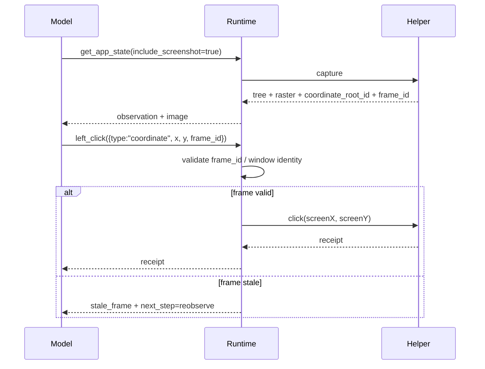
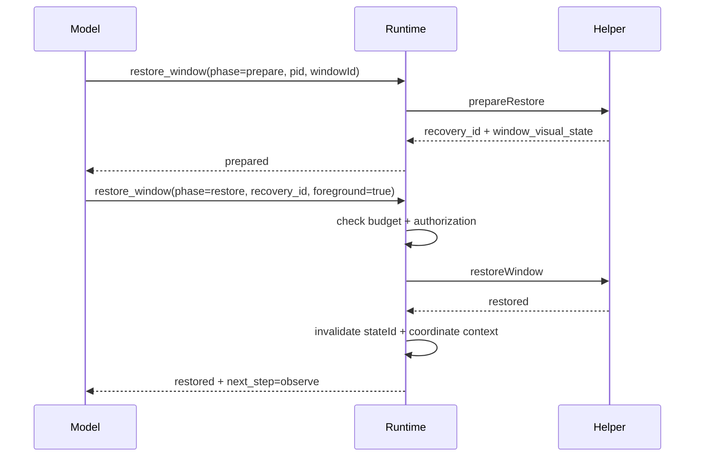
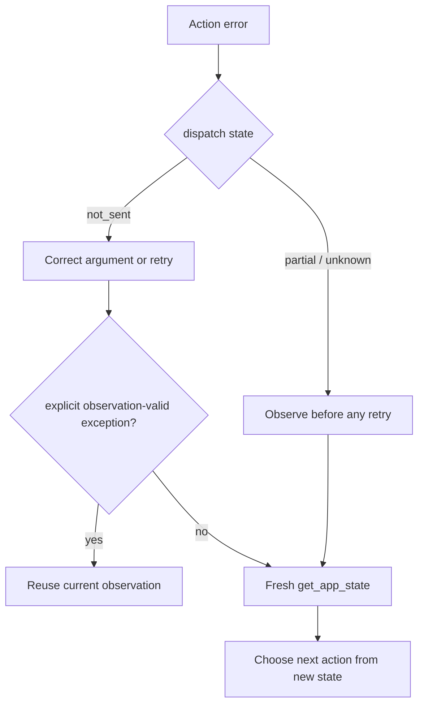

# CUA 能力补全路线图（Windows 自研实现）

- 日期：2026-11-25
- 状态：Draft
- 范围：`packages/raspberrycode-cua` 的 Windows 自研实现，以及 `apps/raspberrycode-cli/packages/raspberrycode-cua-plugin` 的 SDK/Skill 文档
- 依据：`docs/cua/2026-11-19-windows-cua-self-hosted-spec.md`、`docs/cua/2026-11-19-cua-session-decoupling.md`、`docs/cua-permission-broker/raspberrycode-cua-permission-broker.md`、TRAE `TRAE-computer-use-ptc` Skill 契约

## 0. 前置确认

1. **目标构建**：`packages/raspberrycode-cua/package.json` 当前标记 `raspberrycodeCuaPlaceholder: true`，README 声明该构建不包含 Computer Use；但 `src/` 已有自研实现。开工前必须确认：
   - 本路线图针对内部/自研构建；
   - 开源构建是否继续 fail-closed；
   - 若开源构建也要启用，需要单独的发布与安全评审，不在本路线图默认范围。
2. **产品契约对齐**：`docs/testing/cua-e2e-case-catalog.md` 已有坐标权威边界与 CU-30..CU-32、CU-46 等产品级用例；Windows 自研实现新增坐标能力时，必须对齐这些用例的语义，而不是另造一套。
3. **不新增环境变量**：新能力用能力探测 + 宿主策略（如 `prepare`-only schema）控制；如确需配置，先在 `docs/design/v2` 定义用途、优先级、错误行为和测试覆盖。
4. **架构检查**：代码改动前运行 `pnpm architecture:check --changed`，并按需运行 `pnpm architecture:context raspberrycode-cua` 读取受控上下文。

## 1. 目标与非目标

### 目标

- 补齐「不抢焦点也能完成任务」的能力面：坐标点击/拖拽/滚动、定向后台文本输入、受控窗口恢复。
- 把「动作是否发出、下一步做什么」写进收据与错误，降低盲目重试。
- 把「副作用确认」从预算维度中独立出来，补齐动作级确认策略。
- 保持现有优势：任务级干扰预算、按窗口串行队列、收据披露、PiP/操作指示器。

### 非目标

- 不做跨会话/独立桌面（已有六态判定与 creator/host 研究，不在本轮）。
- 不做 SYSTEM 提权。
- 不在第一轮做富文本粘贴（HTML/MD）与剪贴板借用。
- 不追求 macOS 全量对齐；新工具先 Windows 可用，macOS 明确 gating。
- 不用 TRAE 的 background-first 替换现有预算模型；两者是互补维度。

## 2. 现状基线

| 能力 | 当前状态 | 证据 |
|---|---|---|
| 元素点击 | 支持，三级路径 | `packages/raspberrycode-cua/src/helper/action-handlers.ts` |
| 坐标点击 | 不支持，`resolveActionTarget` 明确拒绝 | `packages/raspberrycode-cua/src/runtime/handlers.ts` |
| 坐标拖拽 | 仅元素索引 | `packages/raspberrycode-cua/src/runtime/handlers.ts` |
| 坐标滚动 | 仅 up/down | `packages/raspberrycode-cua/src/runtime/handlers.ts` |
| 文本输入 | 恒物理注入，默认 `balanced` 不可用 | `packages/raspberrycode-cua/src/runtime/handlers.ts` |
| `set_value` | ValuePattern，`balanced` 可用 | `packages/raspberrycode-cua/src/helper/action-handlers.ts` |
| 窗口恢复 | host-only `window_offscreen` | `packages/raspberrycode-cua/src/runtime/handlers.ts` |
| 观察控制 | 固定 800/12/1500ms；`include_screenshot`/`disable_diffing` | `packages/raspberrycode-cua/src/helper/tree.ts`、`runtime/handlers.ts` |
| 错误/收据 | `dispatch_status`/`effect`/`path`/`activates_window` | `packages/raspberrycode-cua/src/runtime/receipts.ts`、`runtime/sdk-contract.ts` |
| 并发 | 按窗口串行队列 | `packages/raspberrycode-cua/src/runtime/window-lanes.ts` |
| 确认策略 | 预算 + 物理注入授权 + 权限引导 | `apps/raspberrycode-cli/packages/raspberrycode-cua-plugin/skills/computer-use/SKILL.md` |

## 3. 路线图总览

| 阶段 | 主题 | 优先级 | 依赖 | 主要产出 |
|---|---|---|---|---|
| P0 | 基线与契约冻结 | P0 | 无 | spec 更新、回归基线、能力矩阵 |
| P1 | 观察与目标模型 | P0 | P0 | `input_target`、`max_depths`、`disable_screenshot`/`disable_diff`、`related_windows`、`coordinate_root_id`、`launch_app`、`list_windows` 过滤 |
| P2 | 坐标动作 | P0 | P1 | 坐标点击/拖拽/滚动、截图上下文、frame 校验 |
| P3 | 定向后台文本输入 | P0 | P1 | `typeIntoElement`、`type`/`paste` 定向路径、`receiver_focus` |
| P4 | 窗口恢复 | P0 | P1/P2 | `restore_window` prepare/restore、单次 `recovery_id` |
| P5 | 错误/收据语义 | P0 | 无（可与 P2-P4 并行） | `delivery`、`next_step`、新错误码、容量/隔离 |
| P6 | 确认策略与 Skill 纪律 | P0 | P5 | 四类确认、observe/act/verify、错误恢复规则 |
| P7 | 并发与状态隔离加固 | P1 | P5 | `target_quarantined`/`cleanup_pending`/`session_capacity_exceeded`、lane 诊断 |
| P8 | 平台、文档与发布 | P1 | 全部 | macOS gating、打包、E2E 目录、发布说明 |

## 4. 阶段详细工作项

### P0 — 基线与契约冻结

**工作项**

1. 运行基线检查：`node scripts/check-workspace-freshness.mjs`、`pnpm typecheck`、`pnpm lint`、`pnpm test:engineering packages/raspberrycode-cua/test/*.test.ts`。
2. 更新 `docs/cua/2026-11-19-windows-cua-self-hosted-spec.md`：新增「坐标动作」「定向文本输入」「窗口恢复」「错误/收据语义」章节。
3. 更新 `docs/cua/2026-08-24-cua-node-repl-sdk-migration-spec.md`：新增工具名、参数、返回值。
4. 在 `docs/testing/cua-e2e-case-catalog.md` 增加 Windows 自研实现的用例编号（建议 CU-W01 起），避免与上游 macOS 用例混淆。
5. 冻结新契约：工具名、参数、收据字段、错误码、预算交互。任何后续实现不得偏离。

**验收**

- 基线检查全绿，或如实记录既有失败。
- spec 评审通过，明确「谁拥有状态、事件顺序、失败语义」。

### P1 — 观察与目标模型

**工作项**

1. `UiaNode` 增加 `inputTarget: boolean`、`valueKnown: boolean`；`render.ts` 输出 `input_target=false`、`val=""` 语义；`elements` 数组带 `input_target`。
2. `get_app_state` 增加 `max_depths`、`disable_screenshot`、`disable_diff`；`max_depths` 透传到 `TraversalBudget.maxDepth`。
3. `get_app_state` 的截图结果增加 `coordinate_root_id`、`coordinate_space`、`frame_id`；`disable_screenshot` 后清除坐标上下文。
4. `get_app_state` 的 structuredContent 增加 `related_windows`（同进程窗口、标题、是否 modal）。
5. 新增 `launch_app({app})`，返回 `pid`/`window_id`；`list_windows` 增加 `scope`/`include_window_ids`/`window_limit`。
6. 更新 `packages/raspberrycode-cua/index.d.ts` 与 `src/runtime/contract-check.ts`，保证公共契约与实现编译期对齐。

**验收**

- 只读节点拒绝元素输入，错误信息指向 `input_target=false`。
- 大树按 `max_depths` 截断，头部标注 `truncated=depth`。
- `disable_screenshot` 后坐标动作返回 `screenshot_context_required`。
- `related_windows` 能提示弹窗；`launch_app` 返回可用 `pid`/`window_id`。

### P2 — 坐标动作

**工作项**

1. `resolveActionTarget` 接受 `{type:"coordinate", x, y}`；坐标必须是 0-1000 归一化，配 `coordinate_space`。
2. `left_click` 坐标路径：优先 `post_message`（零抢焦点），失败/最小化时按预算降级到 UIA/物理注入。
3. `left_click_drag` 坐标路径：`from`/`to` 坐标；物理注入需要 `unrestricted` + 授权。
4. `scroll` 坐标路径：方向 + 页数；优先 UIA ScrollPattern，坐标滚轮需要当前截图。
5. 坐标动作必须绑定当前 `frame_id`/`coordinate_root_id`；窗口移动/缩放/遮挡变化时返回 `stale_frame`，不发送输入。
6. 收据增加 `coordinate_space`、`point`、`frame_id`、`path`。

**验收**

- 画布按钮点击成功，截图验证；不抢焦点（`quiet`/`balanced` 下 `post_message` 路径）。
- 滑块拖拽、列表滚动成功；物理注入路径明确披露 `grab_input`/`cursor_restored`。
- 窗口移动后旧坐标失败且零输入；重新观察后成功。
- DPI 150%、多显示器、负坐标场景通过。

### P3 — 定向后台文本输入

**工作项**

1. Helper 新增 `typeIntoElement`：ValuePattern（整值替换）→ TextPattern/`EM_REPLACESEL`（插入）→ 物理注入兜底。
2. `type` 在提供元素目标时优先定向路径；`paste` 纯文本优先定向路径；`key` 仍保留物理注入（Chromium 忽略 `WM_KEYDOWN`）。
3. 预算：定向路径允许 `balanced`；物理兜底需要 `unrestricted` + `allowPhysicalInjection`。
4. 收据增加 `path=ax_text`、`degraded_from`、`receiver_focus`。
5. 文档说明「定向输入要求元素自身支持原生 Edit receiver；不支持时明确降级」。

**验收**

- Notepad/Chromium/Electron 输入框后台输入成功，焦点不变。
- 不支持定向输入的控件明确降级，收据可追溯。
- 中文、英文、换行、长文本输入正确；无粘滞修饰键。

### P4 — 窗口恢复

**工作项**

1. 新增 `restore_window` 工具：`phase: "prepare"` 只读校验，返回 `recovery_id`、`window_visual_state`；`phase: "restore"` 需要同一 `recovery_id` + `foreground: true`。
2. `restore` 调用 `ShowWindow(SW_RESTORE)` + `SetForegroundWindow`；恢复后清空 `stateId`/坐标上下文，返回 `next_step: observe`。
3. 预算/授权：`restore` 需要 `unrestricted` + `allowPhysicalInjection`（或新增 `allowWindowRestore`，需 spec 定义）。
4. 宿主策略可以只暴露 `prepare`（preparation-only schema），表示当前环境不允许恢复。
5. 收据增加 `recovery_id`、`window_visual_state`、`foreground`。

**验收**

- 最小化窗口恢复后可观察、可操作；恢复后旧 `stateId` 失效。
- 未授权时 `restore` 明确拒绝，不发送输入。
- 恢复失败/连接丢失不自动重放；提示重新观察。

### P5 — 错误/收据语义

**工作项**

1. 扩展 `DISPATCH_ERROR_CODES`：`delivery_unknown`、`partial_dispatch`、`receiver_focus_unknown`、`screenshot_context_required`、`stale_frame`、`target_quarantined`、`cleanup_pending`、`session_capacity_exceeded`。
2. `ClassifiedError` 增加 `next_step: "correct_argument" | "reobserve" | "retry" | "stop"`；`ActReceipt` 增加 `delivery: "not_sent" | "partial" | "unknown"`、`receiver_focus`。
3. 增加「当前观察仍可用于修正此参数」的精确例外；只在工具明确声明时允许复用观察。
4. `state_invalidated` 区分原因：快照淘汰、Helper 重启、元素消失。
5. `SnapshotStore` 达到上限时返回 `session_capacity_exceeded`，提示重建 runtime/关闭会话。

**验收**

- 错误矩阵测试覆盖每个码的 `next_step`。
- `possibly_sent`/`delivery_unknown` 不触发自动重试。
- Helper 重启后旧 `stateId` 返回 `state_invalidated` + `reobserve`。

### P6 — 确认策略与 Skill 纪律

**工作项**

1. 在 `apps/raspberrycode-cli/packages/raspberrycode-cua-plugin/skills/computer-use/SKILL.md` 增加「确认策略」：Hand-Off Required / Always Confirm / Pre-Approval Works / No Confirmation Needed。
2. 增加「观察-行动-验证」循环、批量规则、等待规则、错误恢复规则。
3. 明确「用户输入的指令」vs「第三方内容」；提示注入不得当作授权。
4. 可选：runtime 增加 `requires_confirmation` 标记，宿主复用全局 ConfirmDialog；高风险动作（删除、安装、支付、CAPTCHA、上传）在动作前确认。
5. 更新 `apps/raspberrycode-cli/packages/raspberrycode-cua-plugin/docs/computer-use.md` 的 API 文档与示例。

**验收**

- 删除/安装/支付/CAPTCHA/上传场景按策略确认；预授权场景不重复确认。
- 动作错误后先观察再重试；不自动重放可能已发送的输入。
- 弹窗出现时先读弹窗，不把「元素消失」误判为「动作成功」。

### P7 — 并发与状态隔离加固

**工作项**

1. `target_quarantined`/`cleanup_pending` 状态机：Helper 重启、窗口关闭、目标清理中。
2. `session_capacity_exceeded`：`SnapshotStore` 容量、Helper 会话容量。
3. 写动作始终能拿到 `windowKey`：`get_app_state` 返回 `windowKey`，动作按 `state_id` 反查；必要时 Helper 在 `state_id` 响应里带 `windowKey`。
4. 收据增加 `queued_ms`、`waited_for_session`，让「为什么慢」可归因。
5. 并发验收：同窗口串行、跨窗口并行、切任务不断。

**验收**

- 同窗口两个任务不交错；跨窗口不互相阻塞。
- Helper 重启/窗口关闭时返回明确状态，不静默失败。
- 快照满时提示重建 runtime，不无限重试。

### P8 — 平台、文档与发布

**工作项**

1. macOS：新工具先 Windows 可用；macOS 明确 gating，不声称对齐。
2. 打包：`packages/desktop/scripts/prepare-windows-cua-helper.mjs` 确保新 Helper 方法进入产物；`packages/desktop/src/main/cuaOsSupport.ts` 平台判定。
3. 文档：更新 `docs/cua`、`docs/testing/cua-e2e-case-catalog.md`、`computer-use.md`、`SKILL.md`。
4. 发布：确认 `raspberrycodeCuaPlaceholder` 构建与自研构建的边界；发布说明写清能力矩阵与限制。
5. 回归：`pnpm typecheck`、`pnpm lint`、`pnpm architecture:check --changed`、`pnpm test:engineering`、CLI/CUA 测试、E2E。

**验收**

- 文档与实现一致；E2E 目录覆盖新能力。
- 发布说明明确「Windows 自研实现支持哪些能力、macOS 哪些不支持」。

## 5. 状态与时序

### 5.1 坐标上下文生命周期

**所有者**：Runtime 拥有 `frame_id → windowKey/coordinate_root_id` 映射；Helper 只负责把屏幕坐标派发出去。`disable_screenshot`、窗口移动/缩放、Helper 重启都会使 `frame_id` 失效。

### 5.2 窗口恢复生命周期

**所有者**：Runtime 拥有 `recovery_id` 生命周期与预算/授权判断；Helper 只执行 `ShowWindow`/`SetForegroundWindow`。`recovery_id` 单次使用，prepare 与 restore 之间不得插入其他观察。

### 5.3 错误恢复决策

## 6. 验证矩阵

| 层级 | 内容 | 入口 |
|---|---|---|
| 契约 | 工具 schema、收据字段、错误码、`contract-check.ts` | `pnpm test:engineering packages/raspberrycode-cua/test/*.test.ts` |
| Helper | UIA pattern、坐标换算、定向输入、恢复 | CUA 包测试 + 真实 Windows 探针 |
| Runtime | 路由、预算、窗口队列、错误分类 | CUA 包测试 |
| CLI/SDK | `computer-use-client.mjs`、bridge、broker | `pnpm --dir apps/raspberrycode-cli test` |
| E2E | 画布点击、后台输入、最小化恢复、弹窗、多窗口、DPI | `docs/testing/cua-e2e-case-catalog.md` 新增 CU-W 用例 |
| 门禁 | 类型、Lint、架构、格式 | `pnpm typecheck`、`pnpm lint`、`pnpm architecture:check --changed`、`pnpm fmt:check` |

**必测场景**

- 画布按钮坐标点击；窗口移动后旧坐标零输入。
- Notepad/Chromium/Electron 后台输入；不支持时明确降级。
- 最小化窗口恢复；恢复后旧 `stateId` 失效。
- 弹窗出现时 `related_windows` 提示；先读弹窗再操作。
- 同窗口并发串行、跨窗口并行。
- Helper 重启、快照满、窗口关闭的错误语义。
- DPI 150%、多显示器、负坐标。

## 7. 交付切片与 PR 顺序

| 切片 | 内容 | 依赖 | 可独立合并 |
|---|---|---|---|
| S1 | 观察契约字段（`input_target`、`max_depths`、`disable_screenshot`/`disable_diff`、`related_windows`、`coordinate_root_id`） | P0 | 是 |
| S2 | 坐标点击 + frame 校验 | S1 | 是 |
| S3 | 坐标拖拽/滚动 | S2 | 是 |
| S4 | 定向文本输入 | S1 | 是 |
| S5 | 窗口恢复 | S1/S2 | 是 |
| S6 | 错误/收据语义 | P0 | 是 |
| S7 | 确认策略 + Skill 纪律 | S6 | 是 |
| S8 | 目标隔离/容量 | S6 | 是 |
| S9 | `launch_app` + `list_windows` 过滤 | P0 | 是 |
| S10 | 文档/E2E/发布 | 全部 | 否 |

**PR 描述要求**：每个切片说明背景、设计意图、修改前后行为；bugfix 逐项说明触发场景、根因证据、修复机制、回归验证；涉及状态/时序的切片附上图。

## 8. 风险与回滚

| 风险 | 影响 | 缓解 |
|---|---|---|
| 坐标 DPI/窗口移动导致误点 | 高 | `frame_id` 绑定、`coordinate_root_id`、`stale_frame` 零输入 |
| 定向文本输入不被控件支持 | 中 | 明确降级 + 收据 `degraded_from`；不静默 |
| 窗口恢复抢焦点 | 中 | `unrestricted` + 授权；prepare-only 策略；恢复后清空状态 |
| 错误码膨胀 | 中 | 按 `next_step` 分组；文档化；不新增无状态支撑的码 |
| 确认疲劳 | 中 | 预授权 + 只对高风险动作确认；确认文案说明风险+机制 |
| 构建变体不一致 | 高 | P0 先确认目标构建；发布说明写清能力矩阵 |
| macOS 范围蔓延 | 中 | 新工具先 Windows；macOS 明确 gating |

**回滚**：每个切片独立可回滚；坐标/定向输入/恢复都通过能力探测与宿主策略控制，关闭能力时回到现有元素路径，不改变既有预算与收据语义。

## 9. 度量指标

| 指标 | 基线 | 目标 |
|---|---|---|
| 坐标动作成功率（固定 20 例画布/Electron） | 0（不支持） | ≥ 95% |
| 后台文本输入成功率（Notepad/Chromium/Electron） | 0（默认预算不可用） | ≥ 90% |
| 文本任务中 `unrestricted` 占比 | 高 | 下降 ≥ 50% |
| `possibly_sent` 后盲目重试率 | 未度量 | < 1% |
| 最小化窗口恢复成功率 | 0（不支持） | ≥ 95% |
| 确认误报率（脚本任务集） | 未度量 | < 5% |
| 同窗口并发交错次数 | 0（已串行） | 保持 0 |

## 10. 待对齐问题

1. 目标构建是内部自研构建还是开源构建？开源构建是否继续 fail-closed？
2. 坐标点击在 `balanced` 下走 `post_message` 是否可接受？坐标拖拽/滚动是否必须 `unrestricted`？
3. `restore_window` 是复用 `allowPhysicalInjection`，还是新增独立的 `allowWindowRestore`？
4. `type` 定向路径是否允许 `balanced`？`paste` 是否继续避免剪贴板借用？
5. macOS 是否在本轮补齐坐标/定向输入/恢复，还是明确 gating 到 Windows？
6. 确认策略是纯 Skill 规则，还是需要 runtime `requires_confirmation` + 宿主确认框？

## 11. 实施记录（2026-11-25）

### 已完成

- **P0**：更新 `2026-11-19-windows-cua-self-hosted-spec.md`、`2026-08-24-cua-node-repl-sdk-migration-spec.md`、`docs/testing/cua-e2e-case-catalog.md`（CU-W01..CU-W18）。
- **P1**：`input_target` / `value_known`、`max_depths`、`disable_screenshot` / `disable_diff`、`related_windows`、`coordinate_root_id` / `coordinate_space`、`launch_app`、`list_windows` 过滤。
- **P2**：坐标点击/拖拽/滚动；`frame_id` / `coordinate_space`；`stale_frame` 错误码；坐标动作绑定当前窗口矩形。
- **P3**：`type_into_element`（ValuePattern → `EM_REPLACESEL` → 物理注入兜底）；`type` / `paste` 定向路径；`receiver_focus`。
- **P4**：`restore_window` prepare/restore；单次 `recovery_id`；`allowWindowRestore` 独立授权（设置页「允许恢复最小化窗口」→ `computerUseAllowWindowRestore` → host 环境变量 `RASPBERRYCODE_CUA_ALLOW_WINDOW_RESTORE`）；恢复后清空 stateId/坐标上下文。
- **P5**：`delivery` / `next_step` / `receiver_focus`；`delivery_unknown`、`partial_dispatch`、`receiver_focus_unknown`、`screenshot_context_required`、`stale_frame`、`target_quarantined`、`cleanup_pending`、`session_capacity_exceeded`、`confirmation_required`、`confirmation_denied`。
- **P6**：Skill 增加确认策略与 observe/act/verify 纪律；runtime 增加 `requires_confirmation` / `risk` 与 `requestConfirmation` 端口；未注入端口时走 `confirmation_required` + 单次 `confirmation_id` 两步协议。
- **P7**：写动作收据带 `queued_ms` / `waited_for_session`；`SnapshotStore` 返回 `evicted` 并在观察结果里带 `capacity_exceeded`；Helper 重启/清理映射为 `target_quarantined` / `cleanup_pending`；窗口关闭路径主动返回 `window_closed` 并映射为 `cleanup_pending`（用快照 `windowKey` 判定，不触碰可能失效的 COM 指针）；修复 `stateId → windowKey` 映射读取位置，只带 `state_id` 的动作现在能正确按窗口排队。
- **P8**：README/package.json 更新；`computer-use.md` 与 Skill 更新；E2E 目录新增 Windows 自研用例。

### 部分完成 / 后续

- **宿主确认框**：runtime 的 `requestConfirmation` 端口、node-repl-host 的 MCP elicitation 回调、客户端 `requires_confirmation` / `risk` 透传均已实现并有单测。**但 MCP 2026-07-28 协议不支持执行中的 `elicitation/create`**（真机探针返回 `Method 'elicitation/create' is not supported by the negotiated protocol version (wire era 2026-07-28)`），该版本改用 `input_required` 多轮往返，无法在 `js` 工具执行中途弹窗。**产品决策（2026-11-25）：保留 `confirmation_required` + 单次 `confirmation_id` 两步协议**，由模型用 AskUserQuestion 向用户说明风险并取得同意后带 id 重试；真机 E2E 已验证该路径。`requestConfirmation` 端口保留给未来支持执行中确认的宿主。
- **目标隔离/容量**：已完成。`SnapshotStore` 返回 `evicted` 并在观察结果里带 `capacity_exceeded`；Helper 重启/清理映射为 `target_quarantined` / `cleanup_pending`；窗口关闭路径由 Helper 在动作前用 `windowKey` 判定并返回 `window_closed`，runtime 映射为 `cleanup_pending`（真机 E2E 覆盖）。
- **macOS**：新工具仍 gating 到 Windows；macOS 未实现坐标/定向输入/恢复。
- **真实 Windows 端到端**：画布点击、后台输入、最小化恢复、DPI 150%、多显示器、负坐标仍需真机验证。
- **富文本粘贴/剪贴板借用**：未做；`paste` 仍走纯文本定向输入或 Unicode 物理注入。
- **`windowKey` 兜底**：已修复 `stateId → windowKey` 映射读取位置（`structuredContent.window.key`），只带 `state_id` 的动作现在能正确按窗口排队。

### 真机 E2E 验收（2026-11-25）

用 TRAE 电脑控制驱动桌面 app 完成产品级链路验收，同时用 Helper 级脚本覆盖协议细节。

**Helper 级（16/16 通过）**：`handshake`、`launch_app`、`list_windows`、`capture`（`coordinate_root_id` / `coordinate_space` / `related_windows`）、`capture.input_target`（Notepad `document`）、`type_into_element`（`path=ax_text`、`semantic=em_replacesel`）、写入回读、`screenshot.frame`、坐标 `click`（`post_message`）、坐标 `scroll`（`post_message`）、`select_text`、`restore_window` prepare/restore、窗口关闭后旧 `stateId` 动作返回 `window_closed`。

**产品级（桌面 app → host → agent → node_repl → CUA runtime → Helper → Notepad）**：agent 通过 `launch_app` 启动记事本，`getAXState` 找到 `document "文本编辑器"`（`input_target=true`、`[set_value,type]`），`setValue` 写入 `hello cua e2e`，再次观察确认 13 字符。全链路成功。

**插件门禁修复后的复验**：在设置页开启「电脑控制」并重启 app 后，agent 会话直接加载 `computer-use:computer-use` 技能（不再靠文件系统搜索），`RASPBERRYCODE_CUA_PLUGIN_ROOT` 正确注入。agent 观察到已有 Notepad 窗口，用 UIA press 新建标签页；`balanced` 预算拒绝键盘物理注入后改用 `set_value` 写入，并通过无障碍树与截图双重确认（`value="hello cua e2e"`、13 字符、标题 `*hello cua e2e - Notepad`）。预算约束、观察/动作/验证纪律均按预期生效。

**验收中发现并修复的缺陷**：

1. **Electron 44 开发态判定失效**：`app.isPackaged` 在 `electron .` 启动时也为 `true`（官方文档已说明与 `process.defaultApp` 解耦），导致 dev 主窗口加载不存在的 `out/renderer/index.html`。修复：`isElectronAppPackaged()` 先判 `process.defaultApp === true`，并把 main 进程内所有 `app.isPackaged` 开发/生产分支统一改为该 helper。
2. **`document` 不是输入目标**：`inputTarget` 绑在 `interactive` 上，而 `document` 不在 `INTERACTIVE_KINDS`，记事本编辑区永远 `input_target=false`。修复：`document` 单独放行，只读时仍由 `readonly` 排除；`inferActionsFor` 与渲染同步。
3. **插件门禁与运行时不一致**：`computer-use` 插件默认关闭，但 `captureComputerUseRuntimeFromEnvironment` 只按平台注册自研 runtime，导致插件关闭时 CUA 工具仍可用；同时 `RASPBERRYCODE_CUA_PLUGIN_ROOT` 未注入，Skill bootstrap 会回退到 `RASPBERRYCODE_PLUGIN_ROOT`（browser-use 根）并报 `Cannot find module .../browser-use/.../computer-use-client.mjs`。修复：自研路径要求 `RASPBERRYCODE_CUA_PLUGIN_ROOT` 存在（只在插件启用时注入），并补回归测试；spec §1.21 同步。

### 产品级补充验收（2026-11-25 晚，TRAE 电脑控制驱动）

**画布坐标点击（P2）**：本地 `http://127.0.0.1:8765/` 提供 canvas 页面，agent 绑定 Edge 窗口（pid 8104）后确认画布无 UIA 元素，用坐标 `app.click([648, 424])` 点击；页面自报收到画布内坐标 `(401, 198)`，截图从红色「点击这里」变为绿色「已点击 (401, 198)」，UIA 文本同步变化。**通过**。

**后台定向输入（P3）**：Notepad 编辑区 `document`（`input_target=true`）。`type_into_element` 回执 `path=ax_text`、`semantic=em_replacesel`、`delivery=sent`、`receiver_focus=unknown`、`activates_window=false`、`grabbed_input=false`，中文与换行写入正确，**未抢焦点**。注意：`EM_REPLACESEL` 插入到当前光标处而非末尾；agent 为满足「末尾追加」改用 `set_value`，该路径回执 `activates_window=true` 并确实把 Notepad 提到前台——这是 `balanced` 预算下 UIA 语义动作的既有语义，收据已如实披露。**定向输入本身通过；整任务前台不变未通过，原因是后续 set_value 修正**。

**窗口恢复（P4）**：Notepad 最小化后 `prepare` 成功返回 `recovery_id` 与 `window_visual_state`（`minimized=true`、`offscreen=true`、`rect=-32000,-32000`）；`restore` 在默认设置下被拒绝为 `authorization_required`，回执 `action_sent=false`、`delivery=not_sent`、`next_step=stop`，未发生任何窗口恢复或前台切换。**未授权拒绝路径通过**。

**窗口恢复正向（P4，补齐授权后）**：在设置页开启「允许恢复最小化窗口」并重启 app 后，`prepare` 返回 `recovery_id`，`restore` 用同一 id + `foreground: true` 返回 `ok=true`、`restored=true`、`foreground=true`、`next_step=observe`；`list_windows` 中窗口 bounds 从 `null` 变为 `left=208, top=208, 1109×816`，截图 `blank=false`，标题栏/标签页/编辑区/状态栏完整。键盘物理注入仍按设计拒绝（`allow_physical_injection=false`），agent 改用 `select_text` 验证编辑区可操作、21 字符内容未变。**正向恢复通过**。

**验收中发现的产品缺口**：`allowWindowRestore` 只在 runtime 支持，设置页与 host 注入链都没有它，用户无法授权正向恢复。已补齐：设置页新增「允许恢复最小化窗口」→ `AppSettings.computerUseAllowWindowRestore` → desktop main 快照 → host 环境变量 `RASPBERRYCODE_CUA_ALLOW_WINDOW_RESTORE` → runtime；打开开关时同时把预算提到 `unrestricted`，并补 shared 设置默认值回归测试。补齐后已用上述正向验收确认整条链路生效。

**环境限制**：本机单显示器 1920×1080、DPI 96（100%），多显示器、负坐标与 DPI 150% 场景无法在当前环境验证，保留为待验证项。

